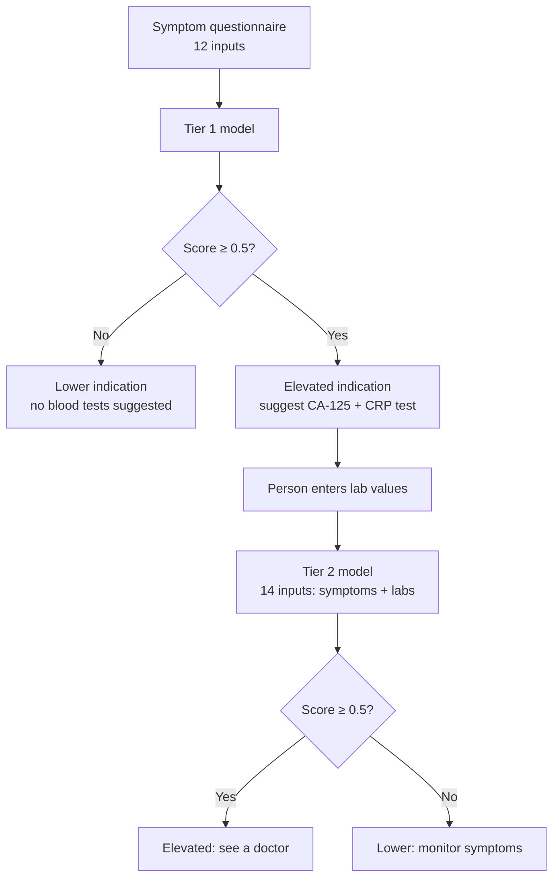
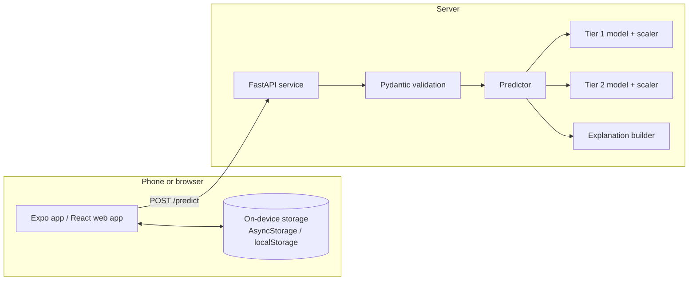

# Enara

**A two-step symptom screening app for endometriosis risk.**

Enara is a mobile app and a website, both backed by a machine-learning API. A person answers a short questionnaire about their cycle and symptoms and gets an instant risk indication. If that indication is elevated, they can add two blood test values (CA-125 and CRP) from a hospital report, and the app re-scores them using both their symptoms and the lab results.

> **Not a medical device.** Enara is a screening and education project trained on a **synthetic dataset**. It cannot diagnose endometriosis and must not be used to make medical decisions. Anyone with severe or persistent symptoms should see a qualified healthcare professional.

---

## Contents

- [Why a two-tier approach](#why-a-two-tier-approach)
- [Features](#features)
- [How it works](#how-it-works)
- [Model performance](#model-performance)
- [Architecture](#architecture)
- [Tech stack](#tech-stack)
- [Project structure](#project-structure)
- [Getting started](#getting-started)
- [API reference](#api-reference)
- [Configuration](#configuration)
- [Testing](#testing)
- [Privacy](#privacy)
- [Limitations](#limitations)
- [Roadmap](#roadmap)
- [License](#license)

---

## Why a two-tier approach

Endometriosis is often diagnosed years after symptoms begin. Symptoms are easy to collect at home, but blood markers need a clinic or lab. Enara mirrors that real-world order of information:

| Tier | Input | Where it happens | Purpose |
|------|-------|------------------|---------|
| **Tier 1** | Cycle details, five symptom scores, history, wellbeing | At home, in the app, in about four minutes | Quick, free first indication |
| **Tier 2** | Tier 1 answers **plus** CA-125 and CRP blood values | After a lab test | Refined estimate to discuss with a clinician |

Tier 2 is only suggested when Tier 1 comes back elevated, so people with a lower result aren’t sent for tests the model doesn’t think they need.

## Features

- **Guided assessment** in three short parts, with a progress bar, 0–10 symptom sliders and input validation. Answers are saved as a draft, so a person can pause and come back.
- **Instant Tier 1 result** from the trained model, with a plain-language explanation.
- **Tier 2 follow-up** for CA-125 and CRP values, producing a combined result.
- **Dashboard** with the latest result, the testing pathway, a symptom snapshot and health details.
- **History** of every saved assessment, with a filter for Tier 1 or combined results.
- **Doctor summary**: share a plain-text summary of answers and scores through the phone’s share sheet.
- **Cycle calendar**: log period days, see the estimated cycle day, phase and next period, and record a daily check-in (flow, pain, mood).
- **Mobile app and website**: the same branding and features in an Expo (React Native) app and a responsive React website with a landing page, About and Privacy pages.
- **Private by design**: results and logs are stored on the device (or in the browser), and the only thing sent to the server is what is needed to compute a score.

## How it works



The 0.5 cutoff is configurable on the backend (see [Configuration](#configuration)).

**Inputs**

| Used by | Features |
|---------|----------|
| Tier 1 and Tier 2 | Age, BMI, cycle length, age at first period, period pain, pelvic pain, pain during sex, painful bowel movements, urinary symptoms, family history, infertility, mental wellbeing score |
| Tier 2 only | CA-125 level, CRP level |

## Model performance

Trained on a dataset of 5,000 records (2,750 negative, 2,250 positive) with a stratified 80/20 train/test split. Logistic regression, random forest and gradient boosting were compared, and logistic regression was selected for both tiers.

Results on the held-out test set (1,000 records) at the 0.5 threshold:

| Model | Accuracy | Precision | Recall | ROC AUC |
|-------|----------|-----------|--------|---------|
| Tier 1 (symptoms only) | 69.4% | 69.1% | 57.8% | 0.75 |
| Tier 2 (symptoms + labs) | 99.7% | 99.3% | 100% | 1.00 |

**Read these numbers carefully.** The dataset is synthetic, so the very high Tier 2 score reflects how the data was generated (CA-125 and CRP separate the two groups almost perfectly), not what a real clinic would see. Tier 1 is the more realistic picture: it misses roughly four in ten positive cases at the default threshold. Lowering the threshold trades more false alarms for fewer missed cases, which is a product decision rather than a purely technical one.

## Architecture



- The **API** validates every request, applies the right scaler, runs the tier logic and returns scores, a recommended next step, a plain-language explanation and any warnings (for example, a value outside the range the model was trained on).
- The **mobile and web apps** keep accounts, results, drafts and cycle logs on the device (or in the browser). They call the API for scores only. The two apps do not sync with each other.

## Tech stack

| Layer | Technology |
|-------|-----------|
| Machine learning | Python, scikit-learn (logistic regression), pandas, NumPy, joblib |
| Backend | FastAPI, Pydantic v2, Uvicorn |
| Mobile app | Expo SDK 54, React Native 0.81, React 19, TypeScript, react-native-svg |
| Website | React 19, React Router, TypeScript, Vite, bundled DM Sans and Fraunces fonts |
| On-device data | AsyncStorage (mobile) and localStorage (web), with a salted password hash for the local sign-in |
| Tests | pytest, httpx / FastAPI TestClient |

## Project structure

```
Enara/
├── app/                    # FastAPI backend
│   ├── main.py             # routes: /predict, /health, /schema
│   ├── predictor.py        # two-tier pipeline
│   ├── schemas.py          # request/response models and validation limits
│   └── config.py           # settings and model-folder discovery
├── ML/                     # machine-learning project
│   ├── data/               # raw data and processed train/test splits + scalers
│   ├── models/             # tier1_model.pkl, tier2_model.pkl
│   ├── reports/            # confusion matrices, ROC curves, feature importance
│   ├── data_preprocessing.py
│   ├── train_model.py
│   ├── evaluate_model.py
│   ├── predict.py          # command-line pipeline and demo
│   └── prediction_explanation.py
├── mobile/                 # Expo app (React Native + TypeScript)
│   ├── App.tsx
│   └── src/                # screens, components, API client, storage, cycle logic
├── web/                    # responsive website (React + Vite), same branding as the mobile app
│   └── src/                # pages, layouts, components, shared logic in src/lib
├── tests/                  # backend tests
├── requirements-api.txt
└── pytest.ini
```

## Getting started

### Prerequisites

- Python 3.11+ (developed on 3.13)
- Node.js 20+ and npm
- The **Expo Go** app on your phone (a build that supports SDK 54), or an Android emulator or iOS simulator

### 1. Backend

```bash
git clone <your-repo-url>
cd Enara

python -m venv .venv
source .venv/bin/activate            # Windows: .venv\Scripts\activate
python -m pip install -r requirements-api.txt

# listen on all interfaces so a phone on your Wi-Fi can reach it
python -m uvicorn app.main:app --host 0.0.0.0 --port 8000
```

Interactive docs are at `http://127.0.0.1:8000/docs`, and `GET /health` should return `{"status": "ok", ...}`.

The pinned scikit-learn version in `requirements-api.txt` matches the one the model files were saved with. Keep it, or retrain the models (below) if you change it.

### 2. Mobile app

```bash
cd mobile
npm install
npx expo start
```

Scan the QR code with Expo Go. The app finds the backend by reusing your computer’s address from the QR code, on port 8000. To use a different address, copy `.env.example` to `.env` and set `EXPO_PUBLIC_API_URL`.

Your phone and computer must be on the same network, and port 8000 must be allowed through your firewall.

### 3. Website (alternative to the mobile app)

```bash
cd web
npm install
npm run dev          # http://localhost:5173
```

It calls the backend on the same host, port 8000 (override with `VITE_API_URL`). For a deployed site, serve it over HTTPS, make sure the host rewrites all paths to `index.html` (Netlify and Vercel files are included), and add its address to `ENDO_CORS_ORIGINS` on the backend. See `web/README.md`.

### 4. (Optional) Retrain the models

```bash
cd ML
pip install -r requirements.txt
python data_preprocessing.py   # splits the data and fits the scalers
python train_model.py          # trains and compares models, saves the best per tier
python evaluate_model.py       # metrics and plots in reports/
python predict.py --demo       # try the pipeline from the command line
```

## API reference

### `POST /predict`

Runs Tier 1, and Tier 2 as well when both lab values are supplied and Tier 1 is elevated.

**Request**

```json
{
  "age": 29, "bmi": 24.5, "cycle_length": 26, "age_of_menarche": 12,
  "dysmenorrhea_score": 8, "pelvic_pain_score": 7, "dyspareunia_score": 6,
  "dyschezia_score": 6, "urinary_symptoms_score": 5,
  "family_history": 1, "infertility_status": 1, "mental_health_score": 4,
  "ca_125_level": 160, "crp_level": 16
}
```

`ca_125_level` and `crp_level` are optional, but must be sent together.

**Response (abridged)**

```json
{
  "tier1": { "probability": 0.879, "elevated_risk": true },
  "tier2": { "probability": 0.999, "elevated_risk": true },
  "next_step": "see_doctor",
  "recommendation": "Tier 2 model indicates elevated predicted risk. Recommend seeing a doctor for clinical evaluation.",
  "explanation": "TIER 1 RESULT ...",
  "warnings": [],
  "threshold": 0.5,
  "disclaimer": "This is a screening prediction from a model trained on a synthetic dataset. ..."
}
```

`next_step` is one of `no_action`, `order_lab_kit`, `see_doctor` or `monitor_symptoms`.

**Validation.** Scores must be 0–10, the yes/no fields must be 0 or 1, and other values must fall within sensible hard limits, otherwise the API returns `422`. A value that is valid but outside the range the model was trained on is accepted with a warning in the response.

### `GET /health`

Returns the status and which models are loaded (type, feature counts, scikit-learn version, threshold).

### `GET /schema`

Lists every input field with its tier, whether it is required and its training range, which is useful for building forms.

## Configuration

Backend settings are environment variables:

| Variable | Default | Purpose |
|----------|---------|---------|
| `ENDO_THRESHOLD` | `0.5` | Probability cutoff for “elevated” in both tiers |
| `ENDO_RUN_TIER2_WHEN_LABS` | `false` | Run Tier 2 whenever labs are sent, even after a lower Tier 1 result |
| `ENDO_CORS_ORIGINS` | `http://localhost:3000,http://localhost:5173` | Allowed browser origins (not needed for native apps) |
| `ENDO_ML_DIR` | auto-detected | Folder containing `models/` and `data/processed/` |

App setting: `EXPO_PUBLIC_API_URL` overrides the backend address.

## Testing

```bash
python -m pytest
```

The suite covers the full API: both tiers, the lab-handling rules, input validation, out-of-range warnings and the configuration switches.

## Privacy

- Accounts, saved results, drafts and cycle logs are stored **on the device only** (in the browser for the web app).
- The app sends the questionnaire answers (and lab values, if entered) to the API to calculate a score. Nothing else leaves the phone.
- The in-app sign-in is a local lock: the password is stored as a salted hash on the device, there is no server account, and “Forgot password” cannot send an email. The account menu includes **Delete my data**.
- If you deploy the API, serve it over HTTPS and decide deliberately whether to log requests, because they contain health information.

## Limitations

- **Synthetic training data.** The models have not been validated on real patients or reviewed by clinicians, so the scores are illustrative, not clinically meaningful.
- **Tier 1 recall is modest** (about 58% at the default threshold).
- **CA-125 and CRP are non-specific markers.** They are not used on their own to diagnose endometriosis in practice, and the near-perfect Tier 2 result is an artefact of the synthetic data.
- **Scores are model probabilities, not calibrated clinical risk.** The app calls them a “pattern match”.
- **No server-side accounts or cloud sync**, so data does not move between devices.
- **Cycle predictions are simple estimates** based on logged periods and the cycle length answered in the assessment.

## Roadmap

- [ ] Validate and recalibrate on real, clinician-reviewed data
- [ ] Server-side accounts with proper password hashing and tokens, plus optional cloud backup
- [ ] Per-prediction explanations that show which answers moved the score
- [ ] HTTPS deployment (Docker), a hosted web build, and production mobile builds with EAS
- [ ] Notifications for period reminders and follow-up check-ins
- [ ] Localisation and accessibility review

## License

Add a license before publishing. [MIT](https://choosealicense.com/licenses/mit/) is a common choice for open projects. Whatever you pick, keep the medical disclaimer at the top of this file.
